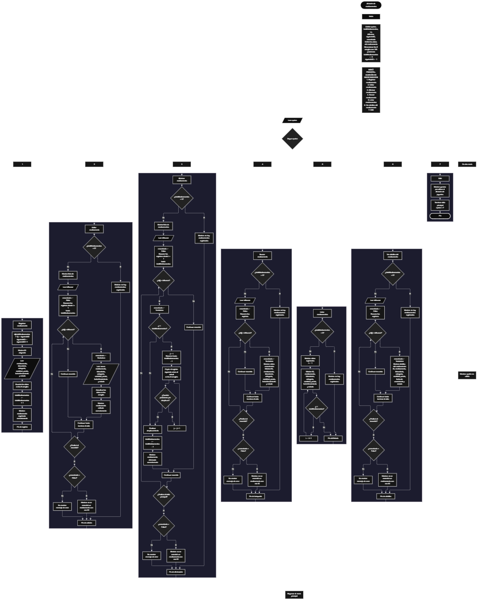

 

Este proyecto, llamado <b>almacén de medicamentos</b>, fue desarrollado en <b>pseint</b> como un ejercicio práctico para fortalecer la lógica de programación mediante la creación de un sistema de gestión de medicamentos desde la consola. El programa cuenta con un menú principal de siete opciones que permite <b>registrar, editar, eliminar, buscar, listar y consultar los detalles</b> de los medicamentos registrados, además de finalizar la ejecución. Cada medicamento almacena información como su identificador, nombre, laboratorio, categoría, cantidad, precio, fecha de vencimiento y estado, utilizando ocho arreglos con una capacidad definida de <b>100 posiciones</b>. Durante su desarrollo se aplicaron conceptos fundamentales de programación, como variables, arreglos, estructuras condicionales, ciclos repetitivos y estructuras de selección, además de procesos para buscar, modificar, eliminar y reorganizar registros. Este proyecto permite poner en práctica los conocimientos adquiridos en PSeInt y sirve como base para desarrollar sistemas de gestión más avanzados utilizando otros lenguajes y tecnologías.

<h2 align="center">⚙️ Funcionamiento del menú principal</h2>

### ➕ Registrar medicamento

La opción <b>1) registrar medicamento</b> permite agregar un nuevo medicamento al almacén. Para comenzar, el programa asigna un identificador mediante la variable <b>siguienteID</b>, cuyo valor inicial es <b>1</b>. Después, incrementa esta variable para que el próximo medicamento registrado reciba un identificador consecutivo. A continuación, solicita el <b>nombre del medicamento, laboratorio, categoría, cantidad, precio, fecha de vencimiento y estado</b>, almacenando cada dato en la posición correspondiente de sus respectivos arreglos. Finalmente, incrementa la variable <b>totalMedicamentos</b> en uno y muestra el mensaje <b>"medicamento registrado correctamente."</b>. Aunque los arreglos están dimensionados para 100 posiciones, el código actual no comprueba si se ha alcanzado esa capacidad antes de registrar otro medicamento.

### ✏️ Editar medicamento

La opción <b>2) editar medicamento</b> permite modificar los datos de un medicamento registrado. Primero, el programa comprueba si la variable <b>totalMedicamentos</b> es igual a <b>0</b>. Si no existen registros, muestra el mensaje <b>"no hay medicamentos registrados."</b>. En caso contrario, presenta una lista con el identificador, nombre, laboratorio, categoría, cantidad, precio, fecha de vencimiento y estado de cada medicamento. Después, solicita el identificador del medicamento que se desea editar y utiliza la variable lógica <b>encontrado</b>, inicializada con el valor <b>falso</b>, para comprobar si existe una coincidencia. Cuando encuentra el identificador solicitado, cambia la variable a <b>verdadero</b>, solicita nuevamente todos los datos del medicamento y actualiza los valores de los arreglos correspondientes. Finalmente, muestra el mensaje <b>"medicamento editado correctamente."</b>. Si termina el recorrido sin encontrar el identificador, presenta el mensaje <b>"no se encontró un medicamento con ese id."</b>.

### 🗑️ Eliminar medicamento

La opción <b>3) eliminar medicamento</b> permite eliminar un medicamento mediante su identificador. Antes de comenzar, el programa comprueba si existen registros. Si el almacén está vacío, muestra el mensaje <b>"no hay medicamentos registrados."</b>. Si hay medicamentos disponibles, presenta sus datos y solicita el identificador del registro que se desea eliminar. Después, inicializa la variable <b>encontrado</b> con el valor <b>falso</b> y recorre los identificadores almacenados. Cuando encuentra una coincidencia, cambia la variable a <b>verdadero</b>. Si la posición del medicamento es anterior a la última posición ocupada, utiliza un ciclo <b>para</b>, controlado por la variable <b>j</b>, para desplazar una posición hacia la izquierda los datos de los arreglos <b>id, medicamento, laboratorio, categoria, cantidad, precio, fechaVencimiento y estado</b>. Posteriormente, disminuye la variable <b>totalMedicamentos</b> en uno y muestra el mensaje <b>"medicamento eliminado correctamente."</b>. Si no encuentra el identificador solicitado, muestra el mensaje <b>"no se encontró un medicamento con ese id."</b>. El código no limpia explícitamente la última posición después de eliminar un registro y continúa el recorrido del ciclo principal después de encontrar una coincidencia.

### 🔎 Buscar medicamento

La opción <b>4) buscar medicamento</b> permite localizar un medicamento mediante su identificador. Primero, el programa comprueba si existen medicamentos registrados. Si el almacén está vacío, muestra el mensaje <b>"no hay medicamentos registrados."</b>. En caso contrario, solicita el identificador del medicamento y establece la variable lógica <b>encontrado</b> en <b>falso</b>. A continuación, utiliza un ciclo <b>para</b> para recorrer los identificadores almacenados y compararlos con el valor introducido mediante la condición <b>id[i] = idBuscar</b>. Cuando encuentra una coincidencia, cambia la variable a <b>verdadero</b>, muestra el mensaje <b>"datos encontrados"</b> y presenta el identificador, nombre, laboratorio, categoría, cantidad, precio, fecha de vencimiento y estado del medicamento. Si finaliza el recorrido sin encontrar coincidencias, muestra el mensaje <b>"no se encontró un medicamento con ese id."</b>.

### 📋 Listar medicamentos

La opción <b>5) listar medicamentos</b> permite visualizar los medicamentos registrados en el almacén. Antes de mostrar la información, el programa comprueba si la variable <b>totalMedicamentos</b> es igual a <b>0</b>. Si no existen registros, presenta el mensaje <b>"no hay medicamentos registrados."</b>. Si hay medicamentos disponibles, muestra el encabezado <b>"datos registrados"</b> y utiliza un ciclo <b>para</b> para recorrer las posiciones ocupadas de los arreglos, desde la primera hasta la correspondiente al total de medicamentos. Durante el recorrido, muestra en una misma línea el identificador, nombre, laboratorio, categoría, cantidad, precio, fecha de vencimiento y estado de cada registro. Esta función permite consultar los medicamentos almacenados sin necesidad de buscarlos individualmente.

### 📄 Ver detalles del medicamento

La opción <b>6) ver detalles del medicamento</b> permite consultar individualmente toda la información de un medicamento específico. Primero, el programa comprueba si existen medicamentos registrados. Si el almacén está vacío, muestra el mensaje <b>"no hay medicamentos registrados."</b>. En caso contrario, solicita el identificador del medicamento que se desea consultar e inicializa la variable lógica <b>encontrado</b> con el valor <b>falso</b>. Después, recorre los identificadores mediante un ciclo <b>para</b>. Si encuentra una coincidencia, cambia la variable a <b>verdadero</b>, muestra el encabezado <b>"detalles del medicamento"</b> y presenta cada campo por separado: identificador, medicamento, laboratorio, categoría, cantidad, precio, fecha de vencimiento y estado. Si finaliza el recorrido sin encontrar el identificador solicitado, muestra el mensaje <b>"no se encontró un medicamento con ese id."</b>.

### 🚪 Salir del menú principal

La opción <b>7) salir</b> está destinada a finalizar la ejecución del programa. Al seleccionarla, muestra el mensaje <b>"gracias por utilizar el almacen de juguetes."</b>. Aunque el mensaje menciona un almacén de juguetes, el programa corresponde al proyecto de almacén de medicamentos. El menú principal se encuentra dentro de una estructura repetitiva <b>repetir ... hasta que</b>, cuya condición de salida es <b>opcion = 7</b>. Por lo tanto, al seleccionar esta opción, el ciclo termina y el algoritmo finaliza correctamente.

<h2 align="center">🧠 Temas aplicados en el proyecto</h2>

### 📦 Variables

En este proyecto se utilizan variables para controlar la opción seleccionada en el menú, contabilizar los medicamentos registrados, recorrer los arreglos, identificar el medicamento que se desea modificar o eliminar, generar identificadores consecutivos y comprobar si se encuentra un registro. También se utilizan variables para almacenar temporalmente los datos de un medicamento durante su definición. Cada variable cumple una función específica dentro de las operaciones de gestión del almacén.

🔢 <b>Opcion:</b> Almacena la opción seleccionada por el usuario en el menú principal.

📊 <b>TotalMedicamentos:</b> Contabiliza la cantidad actual de medicamentos registrados.

🔄 <b>I:</b> Controla los recorridos de los arreglos durante las operaciones de registro, edición, eliminación, búsqueda, listado y consulta de detalles.

🔁 <b>J:</b> Controla el recorrido utilizado para desplazar los datos de los medicamentos durante la eliminación de un registro.

🔎 <b>IdBuscar:</b> Almacena el identificador introducido por el usuario para localizar el medicamento que desea editar, eliminar, buscar o consultar.

🆔 <b>SiguienteID:</b> Genera identificadores consecutivos para los nuevos medicamentos registrados.

✅ <b>Encontrado:</b> Variable lógica que indica si se ha encontrado un medicamento con el identificador solicitado.

📝 <b>Id:</b> Variable entera utilizada para definir el identificador de un medicamento.

💊 <b>Medicamento:</b> Almacena el nombre del medicamento.

🏭 <b>Laboratorio:</b> Almacena el nombre del laboratorio correspondiente.

🗂️ <b>Categoria:</b> Almacena la categoría del medicamento.

📦 <b>Cantidad:</b> Almacena la cantidad del medicamento.

💲 <b>Precio:</b> Almacena el precio del medicamento como un valor real.

📅 <b>FechaVencimiento:</b> Almacena la fecha de vencimiento como un dato de tipo carácter.

📌 <b>Estado:</b> Almacena el estado del medicamento como un dato de tipo carácter.

### 🗃️ Arreglos

En este proyecto se utilizan ocho arreglos para almacenar la información de los medicamentos. Cada arreglo tiene una capacidad definida de <b>100 posiciones</b> y utiliza el mismo índice para relacionar los datos correspondientes a un mismo registro. Por ejemplo, la información del medicamento almacenado en la primera posición se distribuye entre <b>id[1], medicamento[1], laboratorio[1], categoria[1], cantidad[1], precio[1], fechaVencimiento[1] y estado[1]</b>. Esta organización permite recorrer, buscar, modificar, mostrar y reorganizar los registros utilizando las posiciones de los arreglos.

🆔 <b>Id[100]:</b> Almacena los identificadores de los medicamentos.

💊 <b>Medicamento[100]:</b> Almacena los nombres de los medicamentos.

🏭 <b>Laboratorio[100]:</b> Almacena los nombres de los laboratorios.

🗂️ <b>Categoria[100]:</b> Almacena las categorías de los medicamentos.

📦 <b>Cantidad[100]:</b> Almacena las cantidades registradas.

💲 <b>Precio[100]:</b> Almacena los precios de los medicamentos.

📅 <b>FechaVencimiento[100]:</b> Almacena las fechas de vencimiento.

📌 <b>Estado[100]:</b> Almacena los estados de los medicamentos.

### 🔀 Estructuras condicionales

En este proyecto se utilizan las estructuras <b>si</b> y <b>siNo</b> para comprobar si existen medicamentos registrados antes de realizar determinadas operaciones, verificar si un identificador coincide con alguno de los registros, determinar si se encontró el medicamento solicitado y comprobar si es necesario desplazar los datos durante una eliminación. Estas condiciones permiten que el programa ejecute diferentes instrucciones según la situación de los registros y el resultado de las búsquedas.

### 🔄 Estructuras repetitivas

En este proyecto se utilizan los ciclos <b>para</b> y <b>repetir ... hasta que</b>. Los ciclos <b>para</b> permiten recorrer los arreglos para mostrar los medicamentos, localizar identificadores, modificar información y consultar detalles. También se utilizan para desplazar los datos de los registros posteriores durante la eliminación. Por otro lado, el ciclo <b>repetir ... hasta que</b> mantiene activo el menú principal y permite ejecutar diferentes operaciones hasta que el usuario selecciona la opción <b>7</b>.

### 🎯 Estructura según

El programa utiliza la estructura <b>segun opcion hacer</b> para evaluar el valor almacenado en la variable <b>opcion</b> y ejecutar el bloque de instrucciones correspondiente. Cada caso representa una operación específica del sistema: registrar, editar, eliminar, buscar, listar, ver los detalles de un medicamento o salir del programa. Además, utiliza el bloque <b>de otro modo</b> para mostrar el mensaje <b>"opción no válida."</b> cuando el usuario introduce un valor que no corresponde a ninguna de las opciones definidas.

### 🔢 Dimensionamiento de arreglos

El programa utiliza la instrucción <b>dimension</b> para establecer 100 posiciones en cada uno de los ocho arreglos. La variable <b>totalMedicamentos</b> controla cuántos registros se consideran ocupados durante la ejecución. Las operaciones de listado, edición, eliminación, búsqueda y consulta recorren las posiciones desde la primera hasta el total actual de medicamentos. Sin embargo, el código no incluye una condición que impida registrar nuevos medicamentos cuando se alcanza la capacidad definida de los arreglos.

### 🔄 Reorganización de registros

Durante la eliminación de un medicamento, el programa comprueba si su posición es anterior a la última posición ocupada mediante la condición <b>i &lt; totalMedicamentos</b>. Si se cumple, utiliza el ciclo <b>para</b> controlado por <b>j</b> para copiar los datos de la posición siguiente sobre la posición actual en los ocho arreglos. Después, disminuye la variable <b>totalMedicamentos</b> en uno. De esta forma, los registros posteriores se desplazan hacia la izquierda para ocupar la posición del medicamento eliminado. En el código actual, la última posición no se limpia explícitamente y el ciclo que busca el identificador continúa ejecutándose después de la eliminación.

<h2 align="center">¿Cómo se implementaron las operaciones CRUD en el proyecto?</h2>

Las operaciones <b>CRUD</b> se implementaron mediante las opciones del menú principal para administrar los medicamentos registrados. La operación <b>crear</b> corresponde a <b>registrar medicamento</b>, donde se asigna un identificador y se almacenan los datos; <b>leer</b> se realiza mediante las opciones <b>buscar medicamento, listar medicamentos y ver detalles del medicamento</b>; <b>actualizar</b> corresponde a <b>editar medicamento</b>, donde se modifican los datos de un registro existente; y <b>eliminar</b> se realiza mediante la opción <b>eliminar medicamento</b>, que desplaza los registros posteriores cuando corresponde y reduce el total de medicamentos. Estas operaciones utilizan variables, arreglos, condicionales y ciclos para gestionar la información temporalmente durante la ejecución del programa.

<h2 align="center">Diagrama de flujo del proyecto</h2>

<h2 align="center">🛡️ Validaciones del programa</h2>

### 📭 No existen medicamentos registrados

Esta comprobación se utiliza en las opciones de <b>editar, eliminar, buscar, listar y ver detalles del medicamento</b>. El programa verifica si la variable <b>totalMedicamentos</b> es igual a <b>0</b>. Si no existen registros, muestra el mensaje <b>"no hay medicamentos registrados."</b> y evita continuar con la operación que requiere información almacenada.

### ❌ Medicamento no encontrado

Esta comprobación se utiliza en las operaciones de <b>editar, eliminar, buscar y ver detalles</b>. El programa inicializa la variable lógica <b>encontrado</b> con el valor <b>falso</b> y recorre los identificadores almacenados. Cuando encuentra una coincidencia, cambia la variable a <b>verdadero</b> y ejecuta la operación correspondiente. Si termina el recorrido y la variable continúa siendo <b>falso</b>, muestra el mensaje <b>"no se encontró un medicamento con ese id."</b>.

### 🆔 Generación de identificadores

Al registrar un medicamento, el programa utiliza la variable <b>siguienteID</b> para asignar un identificador consecutivo. Su valor inicial es <b>1</b> y aumenta en uno después de cada asignación. La variable no se reduce cuando se elimina un medicamento, por lo que los identificadores nuevos continúan avanzando en lugar de reutilizar los identificadores de los registros eliminados.

### ⚠️ Capacidad de los arreglos

Los ocho arreglos tienen una capacidad definida de <b>100 posiciones</b>. Sin embargo, el código actual no comprueba si <b>totalMedicamentos</b> ha alcanzado ese límite antes de registrar un nuevo medicamento. Por este motivo, no existe una validación que impida superar la capacidad de los arreglos. Esta limitación debe tenerse en cuenta al utilizar el programa con una cantidad elevada de registros.

### 🔢 Opción no válida

La estructura <b>segun</b> incluye el bloque <b>de otro modo</b>, que muestra el mensaje <b>"opción no válida."</b> cuando el valor introducido no coincide con las opciones definidas en el menú principal. La opción de salida está identificada con el número <b>7</b> y coincide con la condición <b>hasta que opcion = 7</b>, por lo que la selección de salida finaliza el ciclo del menú.

<h2 align="center">🎯 Objetivo del proyecto</h2>

El objetivo principal de este proyecto es fortalecer la <b>lógica de programación</b> mediante el desarrollo de un sistema de gestión de medicamentos en <b>pseint</b>. A través de su construcción se busca aplicar los conocimientos adquiridos sobre variables, arreglos, estructuras condicionales, ciclos repetitivos y estructuras de selección, integrándolos para resolver un problema de manera organizada. Además, el proyecto permite comprender cómo registrar, consultar, modificar y eliminar información en una aplicación de consola, utilizando identificadores para localizar los registros y arreglos para almacenar temporalmente sus datos. De esta manera, establece una base para desarrollar sistemas de gestión más completos con otros lenguajes y tecnologías.

